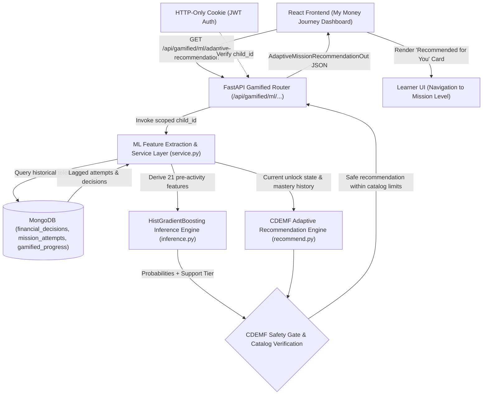

# WiseCub CDEMF — End-to-End ML API Integration & Dashboard Architecture (Checkpoint D)

**Project:** WiseCub — J26-IT-418  
**Module:** Gamified Financial Learning System  
**Branch:** `feature/gamified-learning`  
**Framework:** Competency-Driven Emotional Mission Framework (CDEMF)  
**Target Audience:** Students aged 12–16  
**Status:** Implemented, Tested, and Verified (93/93 tests passing)

---

## 1. Architectural Overview & Telemetry Flow

The WiseCub CDEMF machine learning architecture integrates real-time student gameplay telemetry from MongoDB, computes strictly lagged behavioral features, runs low-latency inference using a trained HistGradientBoosting model, validates recommendations through pedagogical safety arbitration, and surfaces personalized practice cards directly within the "My Money Journey" dashboard.



---

## 2. Real Telemetry Feature Extraction (`service.py`)

Feature extraction is executed on-the-fly from authoritative MongoDB collections scoped exclusively to the authenticated `child_id`. It reconstructs the exact 21 pre-activity feature vector specified during model training:

| Feature Name | Type | MongoDB Source Field & Computation Logic | Lag Verification |
| :--- | :--- | :--- | :--- |
| `mission_id` | `str` | Active mission context (`mission_rescue_puppy`, etc.) | Contextual |
| `level_id` | `str` | Target level ID in `MISSION_CATALOG` | Contextual |
| `interaction_type` | `str` | Level mechanics (e.g., `needs_wants`, `budget_allocation`, `tradeoff`) | Contextual |
| `level_number` | `int` | Level index within the mission (1–8) | Contextual |
| `starting_budget_lkr` | `float` | Level starting budget in Sri Lankan Rupees (LKR) | Contextual |
| `attempt_number` | `int` | Number of previous attempts on current level + 1 | Contextual |
| `is_retry` | `bool` | True if level has prior attempts | Contextual |
| `step_index` | `int` | Total historical attempts count across all missions | Strictly Lagged |
| `hist_completed_levels_count`| `int` | Total unique levels passed across all missions | Strictly Lagged |
| `hist_prior_attempts_count` | `int` | `len(mission_attempts)` | Strictly Lagged |
| `hist_retry_rate` | `float` | Retries count / max(1, total attempts) | Strictly Lagged |
| `hist_remediation_count` | `int` | Count of attempts preceded by a failure | Strictly Lagged |
| `hist_avg_budgeting_score` | `float` | Mean `needs_score` across prior decisions | Strictly Lagged |
| `hist_avg_spending_score` | `float` | Mean `wants_score` across prior decisions | Strictly Lagged |
| `hist_avg_saving_score` | `float` | Mean `savings_score` across prior decisions | Strictly Lagged |
| `hist_avg_investment_score` | `float` | Mean investment decision score (defaults to 0.5) | Strictly Lagged |
| `hist_avg_planning_score` | `float` | Mean `overall_competency_score` across prior decisions | Strictly Lagged |
| `hist_avg_emergency_prep_score` | `float` | Mean emergency allocation ratio across prior decisions | Strictly Lagged |
| `hist_overall_score_avg` | `float` | Overall mean normalized score $\in [0, 1]$ | Strictly Lagged |
| `hist_consecutive_fails` | `int` | Trailing failure streak at moment of prediction | Strictly Lagged |
| `hist_consecutive_passes` | `int` | Trailing pass streak at moment of prediction | Strictly Lagged |

---

## 3. Mounted FastAPI Endpoints

### 3.1. `GET /api/gamified/ml/prediction`
Returns the direct machine-learning classification and class probabilities for the student's next activity.
- **Authentication:** Required (HTTP-Only Cookie containing student JWT).
- **Status Codes:**
  - `200 OK`: Successful inference or safe fallback.
  - `401 Unauthorized`: Missing or invalid session cookie.
- **Response Schema (`MLSupportPredictionOut`):**
```json
{
  "child_id": "child_72a4f0",
  "predicted_support_need": "READY_FOR_STANDARD",
  "confidence": 0.842,
  "model_version": "v1.0.0",
  "prediction_source": "CDEMF_HYBRID_ML",
  "fallback_used": false,
  "fallback_reason": null,
  "class_probabilities": {
    "NEEDS_FOUNDATION_SUPPORT": 0.081,
    "READY_FOR_STANDARD": 0.842,
    "READY_FOR_ADVANCED": 0.077
  }
}
```

### 3.2. `GET /api/gamified/ml/adaptive-recommendation`
Returns an actionable, pedagogically validated learning activity recommendation with human-readable rationale and frontend routing parameters.
- **Authentication:** Required (HTTP-Only Cookie containing student JWT).
- **Status Codes:**
  - `200 OK`: Safe recommendation generated.
  - `401 Unauthorized`: Missing or invalid session cookie.
- **Response Schema (`AdaptiveMissionRecommendationOut`):**
```json
{
  "child_id": "child_72a4f0",
  "recommended_category": "STANDARD",
  "recommended_competency": "Budget Allocation & Emergency Reserves",
  "recommended_mission_id": "mission_rescue_puppy",
  "recommended_mission_title": "Rescue the Injured Puppy",
  "recommended_level_number": 2,
  "recommended_level_id": "level_puppy_2",
  "recommended_level_title": "First Aid & Clinic Visit",
  "recommended_interaction_type": "budget_allocation",
  "recommendation_title": "Continue Your Journey: First Aid & Clinic Visit",
  "explanation": "You've proven your grasp on basic needs. Level 2 will help you practice balancing essential clinic supplies and emergency savings.",
  "pedagogical_action": "Progress along standard curriculum sequence.",
  "is_optional": false,
  "prediction_source": "CDEMF_HYBRID_ML",
  "fallback_used": false,
  "fallback_reason": null,
  "model_version": "v1.0.0",
  "can_navigate": true,
  "safety_audit": {
    "cdemf_mastery_confirmed": true,
    "ml_raw_prediction": "READY_FOR_STANDARD",
    "ml_confidence": 0.842,
    "disagreement_detected": false,
    "disagreement_override_applied": false,
    "unlocked_level_verified": true,
    "override_reason": null
  }
}
```

---

## 4. CDEMF Pedagogical Safety Arbitration Protocol

The system strictly enforces the principle that **machine learning predictions are advisory; CDEMF pedagogical mastery rules remain authoritative**.

1. **Cold-Start Rule:** If a learner has fewer than 2 historical attempts or 0 completed levels, ML inference is bypassed in favor of a rule-based introduction:
   - Tier: `READY_FOR_STANDARD` (category: `FOUNDATION` / introductory).
   - Mission: `mission_rescue_puppy`, Level 1.
   - Reason: `INSUFFICIENT_HISTORY_COLD_START`.
2. **Confidence Safety Threshold:** If the classifier's top probability is below $0.50$, inference is flagged as unreliable:
   - Fallback: Defaults to standard curriculum progression at the student's current unlocked level.
   - Reason: `LOW_CONFIDENCE_<val>_BELOW_0.50`.
3. **Mastery Gate Disagreement Override:** If the ML model classifies a student as `READY_FOR_ADVANCED`, but CDEMF rules indicate the student has unmastered prior levels or recent failure streaks:
   - The engine automatically overrides the tier down to `READY_FOR_STANDARD`.
   - `disagreement_override_applied` is set to `true`.
   - The override reason is logged in `safety_audit.override_reason`.
   - **No locked levels are ever unlocked or bypassed.**
4. **Catalog Feasibility Verification:** Every recommendation is verified against `MISSION_CATALOG`. `recommended_level_number` is strictly constrained by `level <= unlocked_level_number`.

---

## 5. Frontend Dashboard Integration (`MyMoneyJourneyDashboard.tsx`)

The personalized recommendation is rendered in "My Money Journey" as an prominent, engaging card between the high-level metrics and the mission progression list.

- **Visual Design:**
  - Distinctive violet/indigo gradient accent with floating sparkle icon (`✨`).
  - CDEMF Support Tier badge: "Foundation Practice", "Standard Progression", or "Advanced Challenge".
  - Clean typographic hierarchy: mission name, level title, and supportive educational reasoning.
  - Direct "Play Level" CTA button navigating dynamically to `/learn/missions/{missionId}/play/{levelNumber}`.
- **Asynchronous Resilience:**
  - Non-blocking fetching: if recommendation loading fails or network errors occur, the dashboard gracefully continues displaying core analytics without error banners.
  - Skeletons and subtle loaders during initialization.

---

## 6. Verification and Test Suite Coverage

The integration was verified by a complete test suite of **93 passing automated tests**:

| Test Module | Tests | Status | Scope |
| :--- | :--- | :--- | :--- |
| `test_ml_api_integration.py` | 9 | **9 PASSED** | Cookie Auth, Multi-tenant Isolation, Cold-Start, Safety Overrides, Route Formats |
| `test_adaptive_recommendation.py` | 12 | **12 PASSED** | CDEMF Engine, Fallbacks, Disagreement Arbitration, Catalog Bounds |
| `test_ml_held_out.py` | 4 | **4 PASSED** | Held-Out Test Partition Evaluation, Confusion Matrix Integrity |
| `test_ml_training.py` | 5 | **5 PASSED** | Pipeline Training, Stratified K-Fold, Model Persistence |
| `test_synthetic_dataset.py` | 9 | **9 PASSED** | 2,500 Records, 300 Students, Zero Data Leakage |
| `test_journey_analytics.py` | 7 | **7 PASSED** | Overview, Multi-Mission Aggregation, Badge System, CDEMF Milestones |
| `test_panda_mission.py` | 10 | **10 PASSED** | Bao Bao Mission 3, Spending Mechanics, 6 Levels Feasibility |
| `test_squirrel_mission.py` | 9 | **9 PASSED** | Nutty Mission 2, Savings Reserves, 6 Levels Feasibility |
| `test_gamified.py` | 28 | **28 PASSED** | Puppy Mission 1, Budgeting, Core CDEMF State Machine |
| **Total Test Suite** | **93** | **100% GREEN** | **Zero Regressions Across Entire CDEMF Stack** |

Furthermore, the frontend build (`tsc --noEmit && vite build`) executes cleanly with zero TypeScript errors or compilation warnings.
